# StarTrails AI

StarTrails AI is an open-source desktop app for stacking nightscape photographs. It offers two workflows:

| Mode | Use it for | Main capabilities |
| :---: | --- | --- |
| 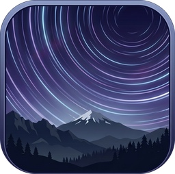 **Startrails** | Long star trails that show the sky's motion | Detect and remove satellite and airplane streaks, create star trail stacks, and fill gaps in the trails. |
| 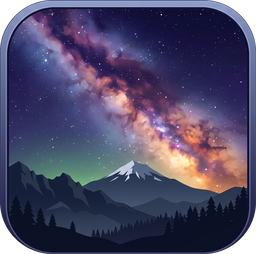 **Denoise** | A cleaner nightscape with point-like stars | Create tight sky masks with sky detection, refinement, and painting tools, align and stack the sky separately from the ground, and tune noise. |

## Get started

Download an installer from [GitHub Releases](https://github.com/gkyle/startrails/releases):

- **Windows 10/11 (x64):** Run `StarTrailsAI-<version>-windows-x64-setup.exe`.
- **macOS 14+ (Apple Silicon):** Open `StarTrailsAI-<version>-macos-arm64.dmg`, then double-click **Install StarTrails AI.app**.

Initial installation needs an internet connection. A compatible GPU can speed up supported processing steps.

To run from source, clone the repository or [download the source ZIP](https://github.com/gkyle/startrails/archive/refs/heads/main.zip). From the extracted folder, run `run.bat` on Windows or `./run.sh` on Linux or macOS. These scripts use **uv** to set up an isolated Python environment and install dependencies.

On the welcome screen, choose **Star Trails** or **Denoise** and create or open a project.

## Startrails workflow

*The [Startrails video walkthrough on YouTube](https://www.youtube.com/watch?v=Jjt-_TK-OC0) demonstrates the workflow. The video is based on an earlier user interface.*

A key feature of Startrails mode is **automatic satellite and airplane streak removal**. These unwanted streaks accumulate when hundreds of exposures are stacked, leaving bright lines across the sky. StarTrails AI finds them in the individual frames and masks those regions before stacking, preserving the natural paths of the stars.

| Streaks retained | Detected streaks removed |
| :---: | :---: |
| [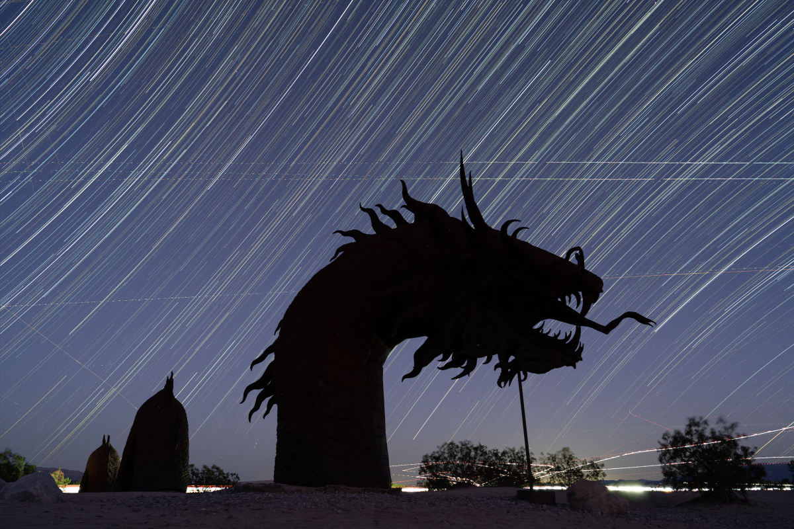](docs/images/startrails_with_streaks.jpg) | [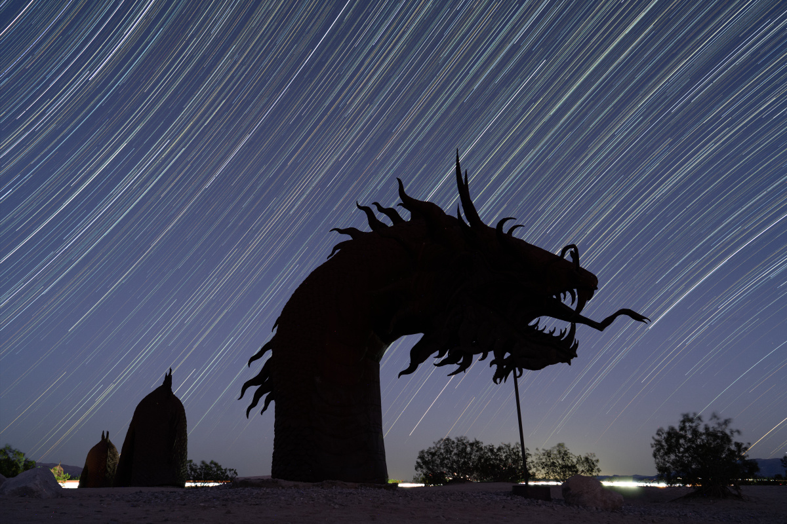](docs/images/startrails_streaks_removed.jpg) |

In this example, both images use the same 517-frame sequence.

To begin, create a Startrails project and add your sequence to **Input Files**.

### Step 1: Detect Streaks

Run **Detect Streaks** to scan the input images. The model marks suspected satellite and airplane streaks with green outlines. You can select individual frames to inspect the detections.

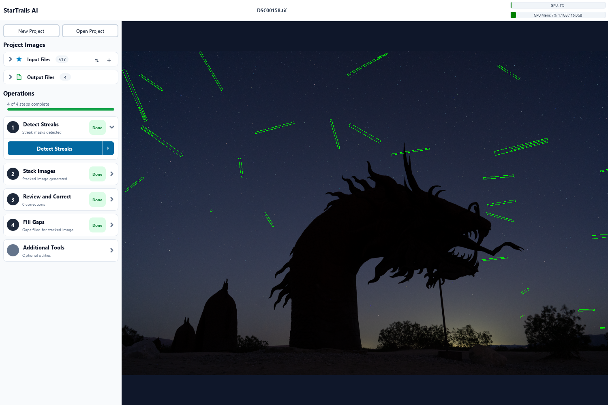

Next, use **Stack Images** with **Streaks** set to **Remove** to build the cleaned stack.

### Step 3: Review and Correct

The model may miss some streaks. After stacking, inspect the result for unwanted lines that remain. If some streaks are still present:

1. Select the stacked image in **Output Files** and zoom in on a streak.
2. In **Review and Correct**, enable **Locate Source Frame**, then click the streak on the image (or use the shortcut: **Shift-click** on the streak). The app uses the stack's saved source map to open a contributing input frame at the **same position and zoom**.
3. Add a mask around a missed streak or adjust an existing mask as needed.
4. Use **Back to Stack** to resume reviewing the result. When your corrections are ready, run **Stack Images** again to apply them.

On an input frame, **right-click** to add polygon points and **left-click** to finish the mask. Drag vertices to adjust its boundary. Manual masks appear in cyan. **Shift-click** a false detection to remove it.

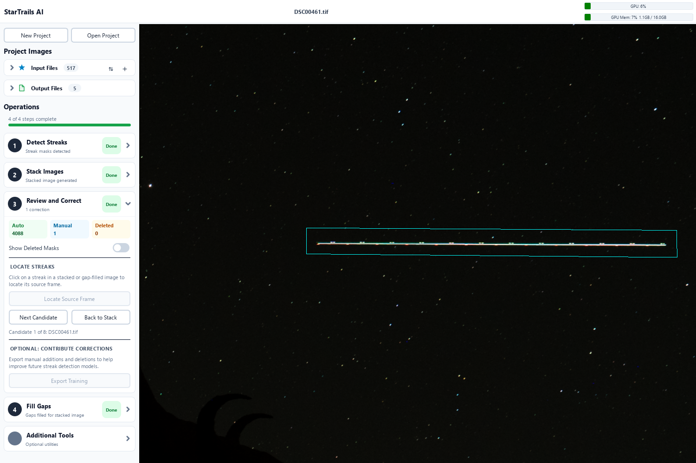

A cyan outline shows an edited mask. Edited masks survive automatic re-execution of Detect Streaks.

### Step 4: Fill Gaps

Masking a streak also removes the star pixels underneath it in that frame. When other frames cannot cover that missing part of a trail, a short gap remains. Pauses between exposures and missing frames can leave gaps too.

Select the cleaned stack in **Output Files**, then run **Fill Gaps**. This step attempts to reconnect interrupted star trails and saves a separate filled image, keeping the original stack available for comparison.

| Before gap filling | After gap filling |
| :---: | :---: |
| [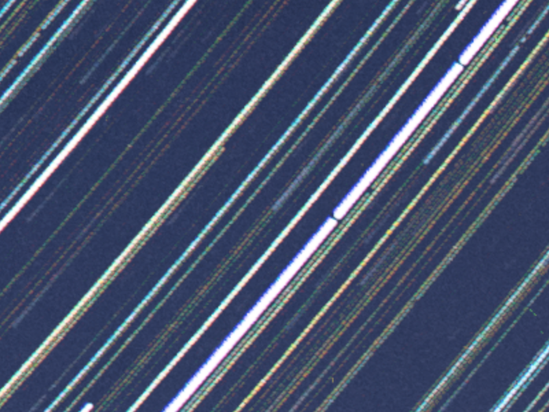](docs/images/startrails_gaps_before.png) | [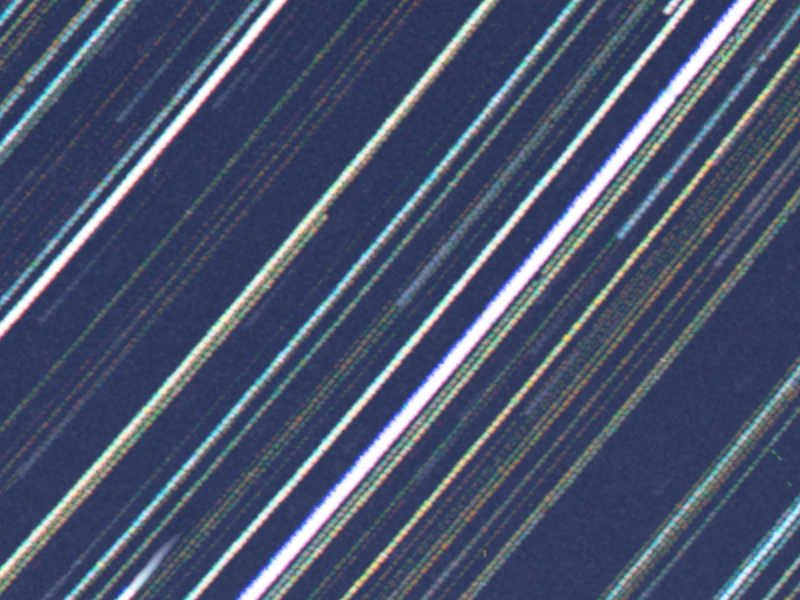](docs/images/startrails_gaps_after.png) |

These close-ups show the same region before and after processing. See the [full finished image](docs/images/startrails_complete.png).

## Denoise workflow

Denoise mode combines a sequence of nightscape exposures while keeping the stars aligned. Two features are especially important to the result: **a tight sky mask** that separates the moving sky from the stationary ground, and **horizon tuning** that helps match noisier areas to the rest of the sky.

| Single reference frame | Final denoise composite |
| :---: | :---: |
| [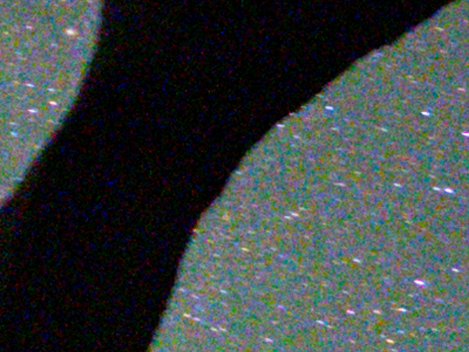](docs/images/denoise_reference.png) |  |

This closeup comparison shows the reference frame from a sequence of input images and the final result from stacking **15 frames**. Click either image to inspect it at full size.

Create a Denoise project and add your exposures to **Star Images**. Optionally add matching dark exposures to **Dark Frames** for calibration. To choose the alignment reference, right-click a star image and select **Set as Reference Frame**.

### Step 1: Define Sky Region

An accurate sky/ground boundary is critical. The mask determines which pixels belong to the sky that will be aligned and which belong to the ground. Inspect detailed edges, including trees, rock formations, and small openings in the foreground.

1. **Detect Sky** creates an automatic starting mask.
2. **Refine Mask** adjusts the boundary to follow the horizon more closely. It searches for local contrast at the edges of the mask to better separate sky from ground. It can be run multiple times and combined with manual painting to improve results.
3. Zoom in and use the **painting tools** to make local corrections. With **Show Mask Overlay** enabled, left-drag paints sky and right-drag erases it. Adjust the brush size for broad areas or fine details.

The green overlay shows the selected sky region. Automated detection, refinement, and manual painting work together so you can get a tight mask before stacking.

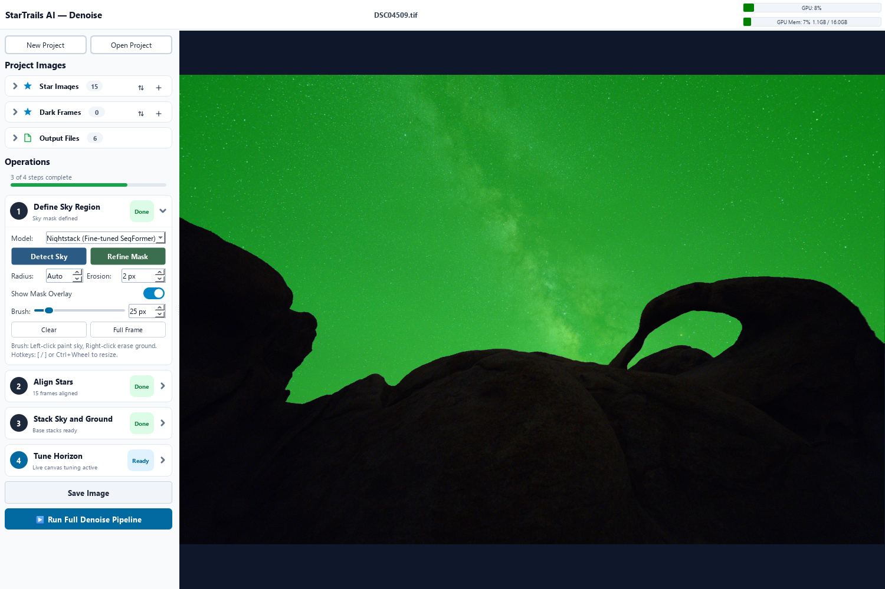

With the mask ready, **Align Stars** finds the transforms needed to align the sky in each frame to the reference frame. **Stack Sky and Ground** then creates separate base stacks. The **Sigma Clipped Mean** method is effective for removing satellite and airplane streaks.

### Step 4: Tune Horizon

As the sky moves between exposures, the aligned sky regions do not overlap everywhere. Near the horizon and the leading edge of the aligned sky, **fewer frames contribute** than in the main sky region. Those areas receive less noise averaging and can look noticeably noisier than the rest of the stack.

Turn on **Show gradient mask (red overlay)** to see where coverage drops. Stronger red indicates a larger shortfall in contributing frames.

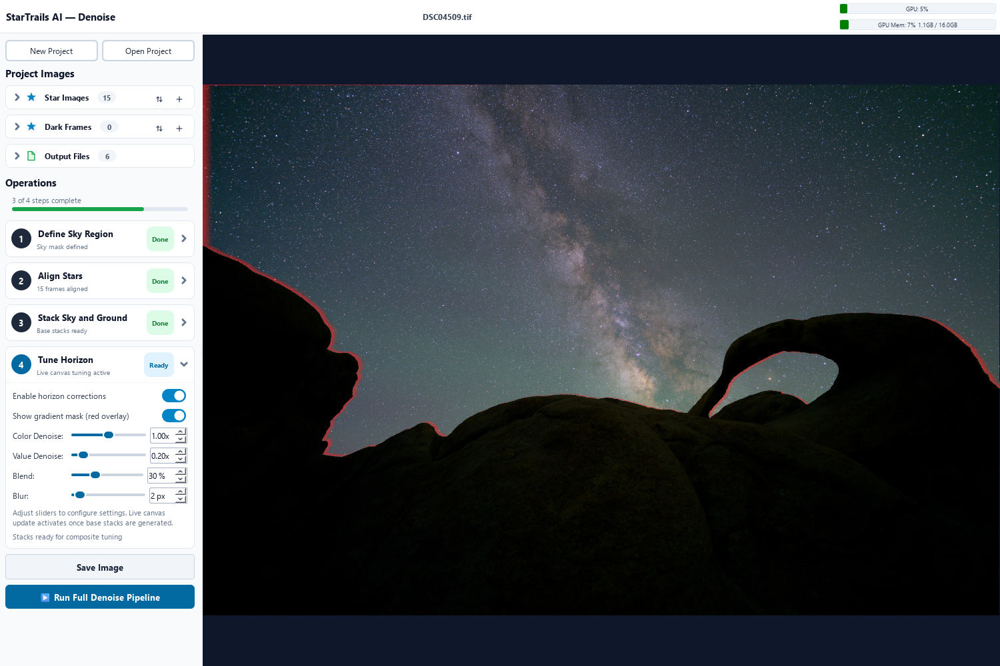

Enable **horizon corrections**, zoom in on a noisy boundary, and adjust the controls while watching the live preview:

- **Color Denoise** reduces colored noise in the affected sky region.
- **Value Denoise** smooths brightness noise in that region.
- **Blend** adjusts how much of the ground-stack image contributes to the transition.
- **Blur** softens the ground-stack contribution used for blending.

The aim is to bring the noise and appearance of the transition area into balance with the surrounding sky. Toggle **Enable horizon corrections** off and on to judge the effect, and inspect both the boundary and nearby stars as you tune.

| Horizon tuning disabled | Horizon tuning enabled |
| :---: | :---: |
| [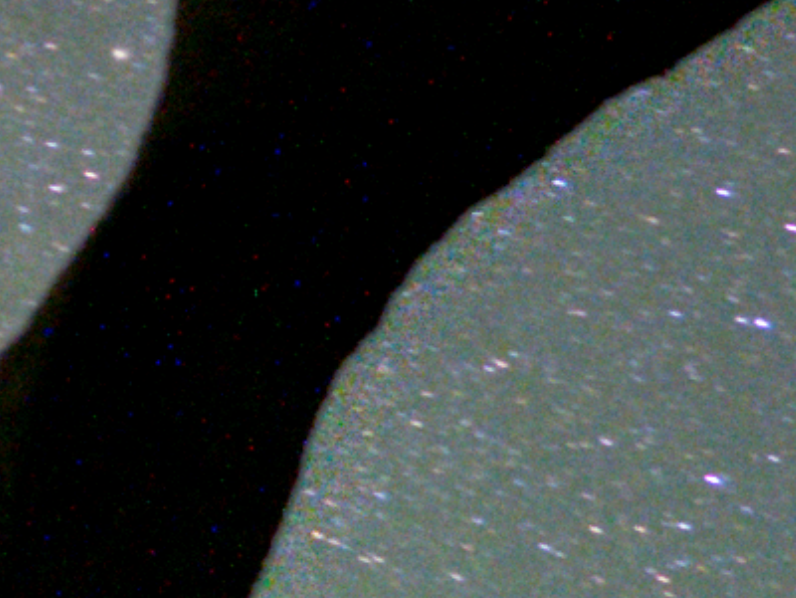](docs/images/denoise_horizon_disabled.png) |  |

This example compares the stack without horizon corrections to the same stack with the default horizon tuning settings.

Use **Save Image** to export the result as TIFF or JPEG.

## Contributing and training

After correcting streaks in **Startrails** mode or painting the sky mask in **Denoise** mode, open **Contribute and Export** in the sidebar.
Choose **Contribute Corrections** to upload training data for review, or **Export to Disk** to save it locally. Contact email is optional when contributing.

Streak data contains 512×512 image crops and labels. Sky data contains a half-size, 8-bit reference image and corrected mask (`image.jpg` and `mask.png`).

The [training dataset](https://github.com/gkyle/startrails/releases/tag/training) and [training notebooks](training/) for streak detection are available.
